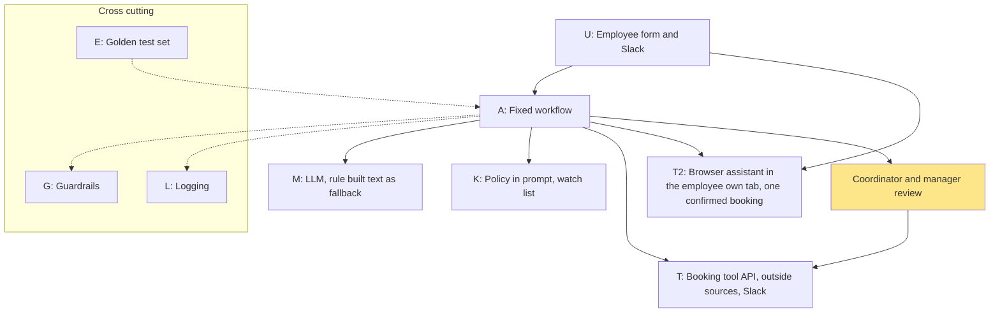

# Architecture: Business trip planner within policy
Pack: travel · v1 · updated 2026-11-13 · Follows ADR-001 (rung 4: LLM workflow with tools)

## Workflow
Main path: a new trip from the form. Slack status questions use a short side path (see Slack path below).

| # | Station | What happens here | Done by | If it fails |
|---|---|---|---|---|
| 1 | Trigger | Employee submits the structured form: destination, dates, purpose, meeting place, profile ID. A form with missing required fields is rejected | System | Form blocks the submit and says which field is missing |
| 2 | Prepare context | Rules classify simple or complex from the form fields. Fetch the pass/fail passport and visa flags from the traveller profile. Search flights and hotels live in the booking tool. Search the named outside sources. Check the watch list | System | Booking tool down: tell the employee and alert the coordinator. Outside source down: continue without outside options. Watch-list match: send to security and stop |
| 3 | AI step | LLM writes the plain-language explanation of 3 options and trade-offs, and the label text for outside options. It receives only trip data and prices, never profile data | AI | Model down or bad output: the package goes out with rule-built text and no explanation |
| 4 | Check | Rules check T1-T5 policy status, cabin, hotel cap, and the outside threshold (15% or $300 cheaper than the best in-tool option). Every price must match a live search result | System | Any mismatch: remove the option. Complex trip: route to a coordinator with the request |
| 5 | Human checkpoint | Coordinator and manager see the package at the same time. Manager signs off the budget on out-of-policy picks. Coordinator checks price range, dates and airports, arrival time, and direct vs non-direct. Coordinator can override | Human | Rejected: back to the employee with the reason. No answer: reminder, then escalate |
| 6 | Act & log | After the needed approvals are recorded, the coordinator clicks to book in the booking tool. The tool charges the card and sends the itinerary. Log the request, options, labels, approvals and outcome | Human click, system | Booking fails: coordinator is alerted and nothing is charged twice |

Outside booking path: the employee picks an outside option. The planner shows the item and total and asks "Can I book this?". Only after the employee confirms, the browser assistant (Claude in the browser) completes that one booking in the employee's own logged-in tab, with their own card and private email. It never types card numbers, passwords or codes, and stops at login, MFA, CAPTCHA, a new-card form or a changed price; the employee then finishes on the site. The coordinator does not book it. The log records site, item, total and confirmation.

Slack path: the employee asks about status or SLA. Rules fetch the trip status from the booking tool. The LLM phrases the answer. If the question is an urgent change, a coordinator is notified and the change fee rule (T9, over $200 needs manager OK) is applied.

```mermaid
flowchart LR
  A1["Employee submits trip form"] --> A2["Rules check required fields"]
  A2 -->|"missing fields"| A1
  A2 --> A3["Rules classify simple or complex"]
  A3 -->|"complex"| C1["Coordinator handles trip"]
  A3 -->|"simple"| A4["Watch list check"]
  A4 -->|"on watch list"| S1["Security team approval first"]
  A4 -->|"clear"| A5["Live search in booking tool"]
  A5 --> A6["Outside source search"]
  A6 --> A7["Rules check policy and threshold"]
  A7 --> A8["LLM writes option explanations"]
  A8 -->|"model down"| A9["Package with rule built text"]
  A8 --> A9
  A9 --> H1["Coordinator and manager review"]
  A9 -->|"outside option picked"| O1["Employee confirms: Can I book this? Item and total shown"]
  O1 -->|"confirmed"| O2["Browser assistant books in the employee own tab"]
  O2 -->|"login, MFA, CAPTCHA, new card or price change"| O3["Assistant stops, employee finishes on the site"]
  O2 --> L1
  H1 -->|"rejected"| A1
  H1 -->|"approved"| B1["Coordinator clicks to book"]
  B1 --> B2["Booking tool charges card and sends itinerary"]
  B2 --> L1["Log request, options and approvals"]
  A5 -->|"booking tool down"| F1["Alert employee and coordinator"]
  style H1 fill:#fde68a
  style O1 fill:#fde68a
```

## Architecture
| Box | Choice |
|---|---|
| **U** User & channel | Employee: structured form for new trips, Slack for status and urgent changes. Coordinator and manager: review in the booking tool or Slack. The employee's own browser for outside bookings. OPEN QUESTION: which form tool |
| **A** App / orchestration | A fixed workflow that runs the stations in order. OPEN QUESTION: which orchestration tool |
| **M** Model(s) | One LLM for explanations, labels and Slack answers. Fallback: rule-built text with no model. OPEN QUESTION: model choice |
| **K** Knowledge | Travel policy (3 pages) placed in the prompt, no retrieval. Watch list: OPEN QUESTION (owner and source) |
| **T** Tools & systems | Booking tool API (search, bookings, traveller profile flags). Outside sources, read only. Slack. Log store. Browser assistant (Claude in the browser) in the employee's own tab, for one confirmed outside booking: no stored credentials, no per-site MCP |
| **G** Guardrails | Rules decide all policy status. No charging or booking by the AI. Prices only from live search or labeled outside results. No profile data to the model. Watch-list trips never packaged. Policy checks always run. Browser assistant: per-booking confirmation of item and total, allowlisted sites, never types card numbers, passwords or codes, hard stop on login, MFA, CAPTCHA, new card or price change, page content treated as data, own card and private email only |
| **L** Logging | Every request, option, label, approval and booking outcome |
| **E** Evaluation | `testset.csv` (16 cases), ship bar at least 14 of 16 with zero critical failures |

## What the AI can touch
| System or data | Read | Write | Notes |
|---|---|---|---|
| Booking tool: flight and hotel search | Yes | No | Live results only |
| Booking tool: traveller profile | Pass/fail flags only | No | Never passport number, date of birth or loyalty numbers (T7) |
| Booking tool: bookings and card charge | No | No | Only a coordinator's click, after approvals are recorded (T8) |
| Outside sources (comparison sites, partners) | Yes | No | Labeled "outside booking tool, unverified" with a link |
| Outside booking sites, in the employee's own logged-in tab | Yes | One booking, only after the employee confirms | Own card and private email already on file. The assistant never types card numbers, passwords or codes, and stops at login, MFA, CAPTCHA, new card or price change. Allowlisted sites only |
| Travel policy | Yes | No | In the prompt |
| Watch list | Check only | No | A match stops the flow and goes to security (T6) |
| Slack | Yes | Yes | Replies and notifications only |
| Log store | No | Yes | Append only |

## Open questions
1. Which tool runs the form, and which orchestrates the workflow?
2. Which model, and what is the model fallback beyond rule-built text?
3. Who owns the watch list, and how does the workflow read it?
4. Is an outside-tool booking reimbursed, and do policy rules T1-T5 still apply to it?
5. How is the booking handed to the browser assistant (a webhook or a direct hand-off), and which sites are allowed?
6. Is it acceptable for the assistant to act in an employee's personal accounts and see those pages (privacy review)?
7. What are the latency and availability targets?
